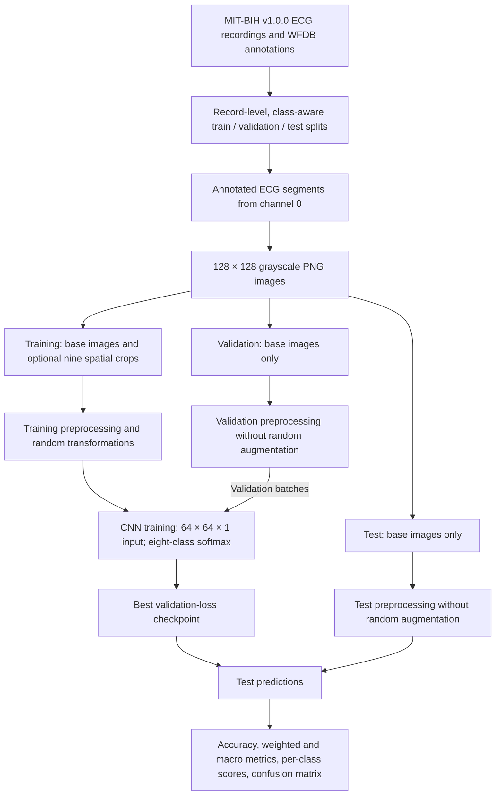
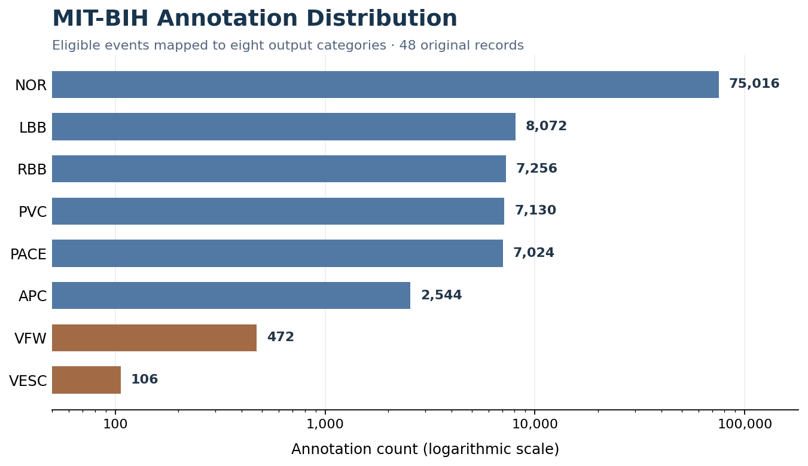
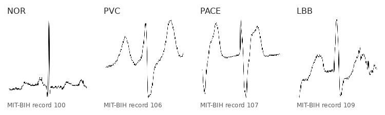
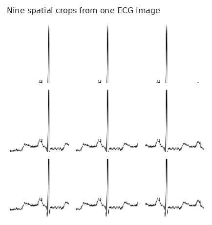
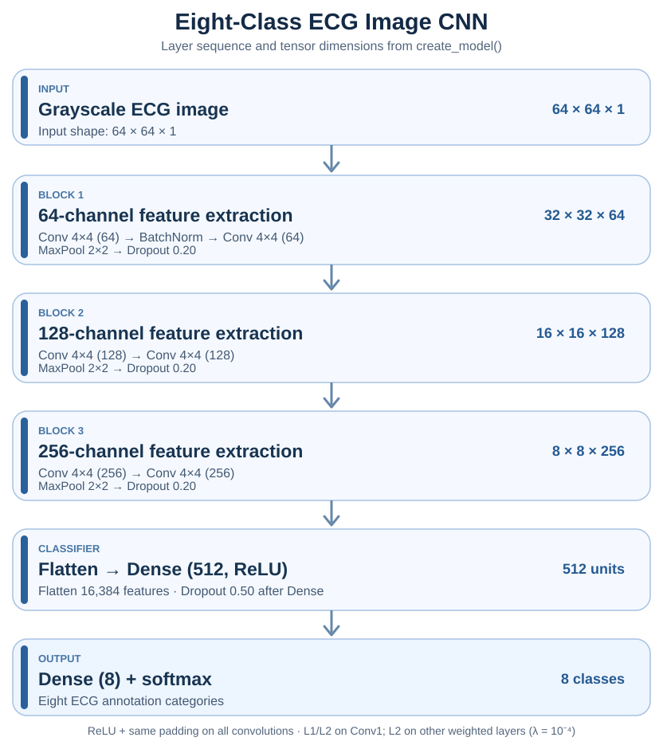

# Classification of Cardiac Arrhythmias from 2D ECG Images in a Remote Monitoring System

A university research prototype that converts annotated electrocardiogram (ECG) segments into grayscale images and uses a convolutional neural network (CNN) to classify eight annotated beat/waveform categories from the **MIT-BIH Arrhythmia Database**. The work explores an image-based approach relevant to the research context of remote cardiovascular monitoring; **it is not a deployed monitoring system, clinical diagnostic device, or validated wearable application**.

Developed at **[Politecnico di Bari](https://www.poliba.it/en/laurea-magistrale-ingegneria-informatica)** as part of the **Master's Degree in Computer Engineering**, **Artificial Intelligence and Data Science** curriculum, for the elective *Remote Monitoring Techniques* course (Academic Year **2024–2025**). The repository provides modular Python code for ECG image generation, CNN training and evaluation.

## Features

- Read ECG signals and reference annotations using WFDB.
- Extract an annotated beat segment using its preceding and following annotation positions, with a 20-sample exclusion margin.
- Render each segment using Matplotlib and convert the plot to a 128 × 128 grayscale image.
- Optionally produce **nine 96 × 96 spatial crops**, each resized to 128 × 128, per original image.
- Perform training-time random rotation and flipping; normalize images to `float32` and prepare categorical labels.
- Train a six-convolution, eight-output CNN with TensorFlow/Keras, or run a small-scale smoke experiment.
- Evaluate predictions with class-weighted and macro precision/recall/F1, accuracy, class support and an eight-class confusion matrix.

## Processing Workflow



The repository provides the image-generation and training pipeline and selected ECG illustrations; the complete generated image collection and pretrained model weights are not distributed.

## Dataset

The [MIT-BIH Arrhythmia Database, version 1.0.0](https://physionet.org/content/mitdb/1.0.0/) provides 48 approximately 30-minute, two-channel ECG recordings from 47 subjects. This repository uses **the 48 primary record triplets** (`.dat`, `.hea`, `.atr`); the unrelated `x_mitdb/` directory is not required. The database is distributed by PhysioNet under the [Open Data Commons Attribution License v1.0](https://physionet.org/content/mitdb/view-license/1.0.0/).

> **Data attribution:** Moody, G., & Mark, R. (2005). *MIT-BIH Arrhythmia Database* (version 1.0.0). PhysioNet. [doi:10.13026/C2F305](https://doi.org/10.13026/C2F305). The underlying data and the ECG-derived example images are attributed to PhysioNet under [ODC-By v1.0](https://physionet.org/content/mitdb/view-license/1.0.0/).

The official database is **not committed** to this repository. From the project root, the notebook can download the records automatically from PhysioNet. Alternatively, manually extract the official PhysioNet ZIP, placing the primary `.dat`, `.hea`, and `.atr` files under:

```text
mit-bih-arrhythmia-database-1.0.0/
  100.dat
  100.hea
  100.atr
  ...
  234.dat
  234.hea
  234.atr
```

The downloader verifies every extracted record against **144 pinned SHA-256 checksums** in [`src/ecg_classification/resources/mit_bih_primary_sha256.txt`](src/ecg_classification/resources/mit_bih_primary_sha256.txt). These checksums were taken from the `SHA256SUMS.txt` in the original university dataset archive and matched the supplied data. The notebook also verifies manually supplied datasets before preprocessing. This protects against accidental corruption or a replaced download, but does **not** independently authenticate the original archive's provenance; for stronger provenance assurance, compare the hashes with PhysioNet's published manifest.

### Eight Output Categories

The eight output indices follow the original model design. The symbols are interpreted using the official WFDB annotation definitions:

| Output index | WFDB annotation | Current label | Meaning |
|---:|---|---|---|
| 0 | `N` | `NOR` | Normal beat |
| 1 | `V` | `PVC` | Premature ventricular contraction |
| 2 | `/` | `PACE` | Paced beat |
| 3 | `L` | `LBB` | Left bundle branch block beat |
| 4 | `R` | `RBB` | Right bundle branch block beat |
| 5 | `A` | `APC` | Atrial premature beat |
| 6 | `!` | `VFW` | Ventricular flutter wave (non-beat annotation) |
| 7 | `E` | `VESC` | Ventricular escape beat |

The official WFDB definitions distinguish beat annotations from waveform events. For example, `!` is a ventricular flutter wave rather than an individual heartbeat. The glyph `·` used by some plotting tools to display the `N` code should not be confused with a separate `.` annotation. See [PhysioNet annotation definitions](https://physionet.org/static/lightwave/doc/annotations.html).

### Class Distribution in MIT-BIH Annotations



*Log-scale distribution of eligible MIT-BIH annotation events.*

Counts were computed from the 48 primary MIT-BIH version 1.0.0 annotation files using the pipeline's eight-category symbol mapping and the requirement that the adjacent annotations leave a nonempty segment after 20-sample margins. They describe **107,620 eligible annotation events before record splitting**, not generated PNGs, training samples or model predictions. The `VFW` category corresponds to ventricular flutter-wave events rather than isolated beats. The logarithmic x-axis makes rare categories visible; the data are strongly imbalanced.

## Example ECG Images



*Representative ECG images from four annotation categories.*

Representative grayscale plots generated from [MIT-BIH Arrhythmia Database](https://physionet.org/content/mitdb/1.0.0/) recordings 100, 106, 107 and 109 using this project’s ECG-to-image procedure. Source ECG data: PhysioNet, [ODC-By v1.0](https://physionet.org/content/mitdb/view-license/1.0.0/).



*Nine spatial crops derived from a single ECG image.*

Nine spatial crops derived from an ECG plot based on PhysioNet MIT-BIH data ([ODC-By v1.0](https://physionet.org/content/mitdb/view-license/1.0.0/)). The complete generated PNG dataset is not included in the repository and can be regenerated using the notebook.

## CNN Architecture



*Convolutional network architecture for eight output categories.*

Architecture diagram derived from [`create_model()`](src/ecg_classification/model.py), showing the 64/128/256-filter stages, batch normalization, pooling and dropout.

The model implemented in [`model.py`](src/ecg_classification/model.py) has the following architecture and training settings:

- Input: `64 x 64 x 1` grayscale image; output: eight-class softmax.
- Six convolutional layers: two at 64 filters, two at 128 filters, and two at 256 filters; kernel size `4 x 4`, ReLU activation and `same` padding.
- Max pooling after each two-convolution block; dropout `0.20` after each block.
- Batch normalization after the first convolution.
- Flatten, dense layer of 512 ReLU units, dropout `0.50`, final 8-unit dense layer.
- L1/L2 penalty on the first convolution; L2 on later convolutions/dense layer; regularization coefficient `0.0001`.
- Adam optimizer, categorical crossentropy, batch size `32`, default training duration **30 epochs**, and best-checkpoint monitoring of validation loss.

No architecture search, compression, quantization, latency benchmark, or embedded deployment is supplied.

## Repository Structure

```text
ecg-arrhythmia-image-classification/
├── README.md
├── pyproject.toml
├── notebooks/
│   └── experiment.ipynb
├── scripts/
│   └── smoke_test.py
├── src/
│   └── ecg_classification/
│       ├── __init__.py
│       ├── data.py
│       ├── model.py
│       ├── evaluation.py
│       └── resources/
│           └── mit_bih_primary_sha256.txt
├── tests/
│   ├── test_data.py
│   ├── test_download.py
│   ├── test_evaluation.py
│   ├── test_generation.py
│   └── test_model.py
└── docs/
    ├── academic-report-it.pdf
    ├── references.md
    └── images/
        ├── ecg_examples.png
        ├── ecg_crops.png
        ├── cnn_architecture.svg
        └── class_distribution.png
```

## Getting Started

The original academic experiment used Google Colab; its exact software versions were not recorded. The `pyproject.toml` provides explicit versions for the project’s direct Python dependencies in a modern, repeatable setup rather than attempting to recreate the historical environment. Use **Python 3.13** (Python 3.11–3.13 is declared as supported by this project). A virtual environment keeps the project dependencies separate from other Python installations. TensorBoard is included because model training uses the TensorBoard callback to write event logs.

Install in a new virtual environment from the repository root:

```bash
python -m venv .venv
source .venv/bin/activate  # On Windows: .venv\Scripts\activate
python -m pip install --upgrade pip
python -m pip install -e ".[notebook,test]"
python -m pip check
python -m pytest -q
```

To additionally lock all transitive dependencies, install [uv](https://docs.astral.sh/uv/getting-started/installation/) and run the following alternative installation workflow from the repository root:

```bash
uv lock
uv sync --all-extras --locked
uv pip check
uv run --locked python -m pytest -q
```

The `uv.lock` file captures the resolved transitive dependency versions for reuse. Once generated and checked, it can be tracked alongside `pyproject.toml`; subsequent installations use `uv sync --all-extras --locked`. Before committing changes, review staged files with `git status` to avoid including `.venv/`, downloaded ECG data, generated PNGs, or model checkpoints.

For a local notebook session:

```bash
jupyter notebook notebooks/experiment.ipynb
```

In Colab, first obtain the repository in the runtime (e.g., by cloning it), install the package from the repository root, and select the desired runtime hardware.

## Usage

The notebook is the primary walkthrough: [`notebooks/experiment.ipynb`](notebooks/experiment.ipynb). It includes dataset preparation, record-level splitting, image generation, training, and evaluation using the modules in `src/ecg_classification/`.

**Quick functionality check:** Use the notebook defaults `MAX_BEATS_PER_RECORD = 5`, `EPOCHS = 1` and `INCLUDE_TRAIN_CROPS = False`. These exercise the workflow on a small sample, not clinical performance. Image generation traverses each record but accepts only five eligible annotation events. No unused nine-crop images are produced by default.

**Full data preparation:** Set `MAX_BEATS_PER_RECORD = None` and `EPOCHS = 30` and decide whether training needs nine-crop augmentation via `INCLUDE_TRAIN_CROPS`. Full preparation and training are computationally and storage intensive, especially with crops enabled.

### Runtime Configuration

The notebook defines its settings directly in its first code cell:

| Setting | Default | Purpose |
|---|---|---|
| `DATASET_DIRECTORY` | `mit-bih-arrhythmia-database-1.0.0/` | Location of the official MIT-BIH records |
| `IMAGE_DIRECTORY` | `dataset_images/` | Destination for generated PNGs |
| `CHECKPOINT` | `cnn.h5` | Best-model checkpoint path |
| `MAX_BEATS_PER_RECORD` | `5` | Per-record cap; use `None` for all eligible events |
| `EPOCHS` | `1` | Number of training epochs; use `30` for the intended full run |
| `INCLUDE_TRAIN_CROPS` | `False` | Generate and load nine additional crops for each training image |
| `SEED` | `0` | Record splitting and training seed |

All paths are relative to the repository root by default. The separate smoke-test script accepts `--dataset PATH`, `--download` and `--beats N` (default `2`); use `python scripts/smoke_test.py --help` for its CLI options.

The preprocessing writes to `dataset_images/<partition>/<class>/`. Reprocessing a recording replaces its previously generated PNGs in that partition, preventing stale outputs when the beat limit or crop setting changes. Downloads, bulk-generated PNGs, logs and weights are not included in the published repository. Stage only the intended source files and documentation when committing changes. The generated data are partitioned by **record**, with the assignment selected deterministically to improve the presence of rare classes in the available partitions. Base `...0.png` images are used by default. Set `INCLUDE_TRAIN_CROPS = True` to **generate and load** nine spatial crops per training image only. Validation and test generate base images only. Validation and test use base images without random rotations or flips.

A completed training run writes the best checkpoint to `cnn.h5` (generated locally and not included in the repository); inference requires that checkpoint or an explicitly supplied trained model. If no model has been trained, the evaluation section cannot be executed.

## Tests

```bash
python -m pytest -q
```

The test suite covers record splitting (including rare categories), image generation and cropping, image loading, checksum validation and downloader error handling, and weighted/per-class metric calculations. The CNN architecture test constructs the TensorFlow model using the declared dependencies.

### Real-Data Integration Smoke Test

After installing the project dependencies, the following optional command runs a **real-data, single-epoch integration test** using one training, one validation and one test recording. It verifies the entire workflow including WFDB reading, image generation, TensorFlow training, saving/loading a checkpoint and inference. It prints installed package versions and uses a temporary workspace for all outputs:

```bash
python scripts/smoke_test.py --dataset mit-bih-arrhythmia-database-1.0.0
```

To download the official records first, add `--download`. The script validates the 144 pinned hashes even when files are supplied manually. The script uses a small sample to exercise the software pipeline; use the notebook to conduct larger experiments.

## Evaluation Interpretation

`evaluate_predictions()` returns backward-compatible weighted precision, recall and F1, plus accuracy, all-eight-class macro precision/recall/F1, class-specific scores and support (number of ground-truth test events), and an eight-class confusion matrix. **Macro scores include all eight outputs**, assigning zero to undefined scores. A class with `support=0` has not been evaluated in the test partition; its zero score is not evidence of model performance. The default five-beat demo does not cover all classes. Use the per-class support figures when interpreting any metrics, and do not compare new record-disjoint results directly with the historical report.

## Class-Aware Partitioning

A deterministic record-level split assigns approximately 70% of the 48 MIT-BIH recordings to training and distributes the remainder between validation and test. Before partitioning, `record_class_labels()` reads the annotations to identify which of the eight output categories occur in each recording. `split_records()` then searches for a partition that:

1. Retains all observed categories in the training recordings.
2. Includes categories in both validation and test when at least three source recordings permit this.
3. Includes categories in at least one holdout when two source recordings permit this.
4. Never duplicates a recording across partitions.
5. Keeps recordings **201 and 202 together**, because PhysioNet identifies them as originating from the same patient.

A class supported by only one recording cannot appear in multiple partitions without overlap. In the MIT-BIH dataset, the ventricular flutter wave annotation `!` occurs only in recording 207, which is therefore kept in training. The notebook prints the resulting class-presence table.

This is a record-level split with an explicit same-patient constraint for the known shared-subject pair (201 and 202). PhysioNet documents 48 recordings from 47 subjects. It is not an independently validated clinical inter-patient evaluation; this pipeline is a research prototype and must not be used for clinical decisions.

## Academic Experiment

**The original academic experiment's reported results do not constitute a validated evaluation of the record-disjoint pipeline in this repository.** To produce new predictions, prepare the dataset and train a model with the supplied code. The original methodology and results are described in [Documentation](#documentation).

## Scope and Future Work

- Pretrained weights, generated preprocessing outputs and training execution traces are not distributed.
- Direct dependencies are version-pinned in `pyproject.toml`; the *Installation* section also describes how to generate a lockfile for transitive dependencies.
- Full-scale experiments require adequate computational resources; the quick smoke experiment is not intended to establish scientific accuracy or GPU performance.
- The eight-class taxonomy includes the `!` ventricular flutter wave event, which is a non-beat annotation.
- A category found in only one recording cannot be included in several record-disjoint partitions; this is reported by the notebook. Records 201/202 stay in the same partition to prevent their shared patient from leaking across splits.
- No remote monitoring integration, clinical certification, clinical performance study or resource-constrained deployment is included.
- Further research could explore rigorous inter-patient evaluation, deterministic training, calibration, and on-device performance, but none of these are presented as completed work.

## Documentation

The [65-page academic report (Italian, PDF)](docs/academic-report-it.pdf) is preserved in its original language. The academic report is written in Italian, as required by the university examination. It documents the research background, methodology and experimental results of that examination. The report is preserved unchanged; this README provides the English-language technical documentation for the repository.

The related publications and dataset citations are collected in [Scientific References](docs/references.md).

## Contributors

- [Cosimo Curri](https://github.com/cosimo-curri)

## License and Third-Party Materials

The original project code is licensed under the [MIT License](LICENSE). Third-party materials remain subject to their respective licenses and terms.

MIT-BIH recordings and annotations are provided by [PhysioNet](https://physionet.org/content/mitdb/1.0.0/) under the [Open Data Commons Attribution License v1.0](https://physionet.org/content/mitdb/view-license/1.0.0/). This dataset license is independent of the MIT license for the original repository code and does not separately establish redistribution rights for figures reproduced in the academic report.

The repository documents an academic research prototype and is not intended to diagnose, treat, or monitor patients in clinical practice.
